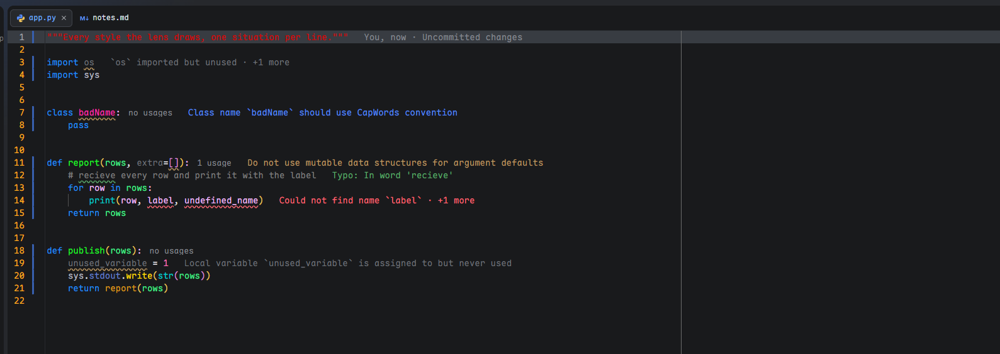
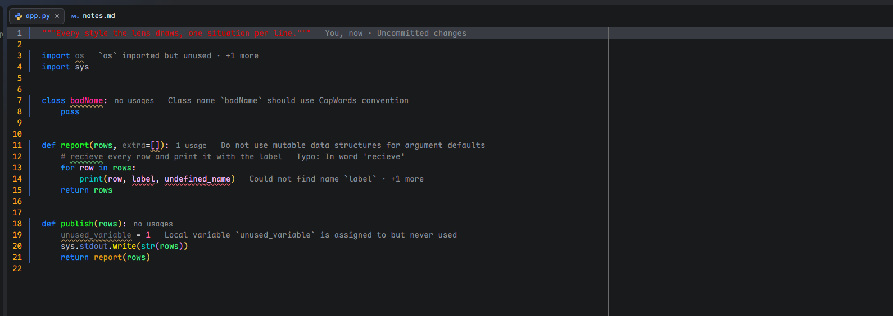
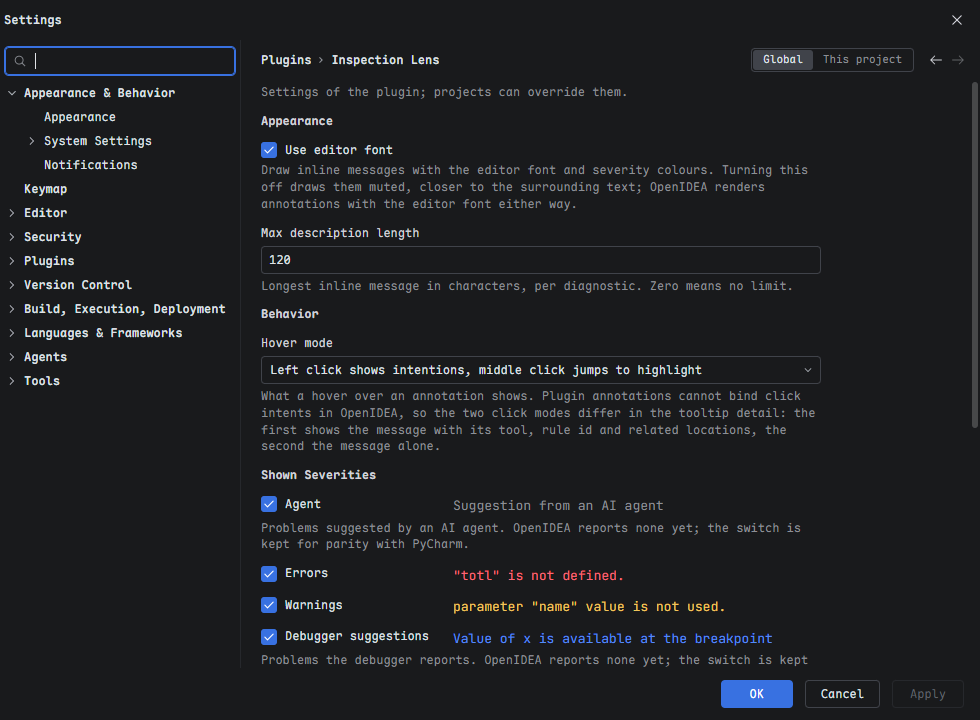

# Inspection Lens — inline diagnostics for OpenIDEA

Draws each diagnostic at the end of the line it belongs to, coloured by
severity, with a native hover tooltip — the way JetBrains' Inspection Lens and
VS Code's Error Lens do it.



Everything in the screenshots comes from [`demo/`](demo) — a throwaway project
whose problems are deliberate. Open it to see the same thing:

```sh
git clone https://github.com/muutot/openidea-inspection-lens
# Settings › Plugins › Install Plugin from Disk… and pick the clone,
# then open the clone's demo/ folder.
```

## What it draws

One annotation per line, at the end of the code: the first message, then
`· +N more` when the line has more. The hover carries every message (or the
full one, with tool, rule id and related locations, depending on the hover
mode). The host renders it out of flow, so it neither stretches the line nor
moves the caret, and it sits after the git hint and before the inline blame.

| Style | Category | What produces it in the demo |
| --- | --- | --- |
| `error` | Errors, Syntax errors, Server problems | `print(row, label, undefined_name)` — the Python server finds no `label` |
| `warning` | Warnings | `def report(rows, extra=[])` — ruff `B006`, a mutable default |
| `weak` | Weak warnings (`unnecessary`, `deprecated`) | `import os`, `unused_variable = 1` — ruff `F401` / `F841` |
| `info` | Information, Style, Debugger, Agent | `class badName` — ruff `N801`, a naming convention |
| `typo` | Typos | the comment in `app.py`, `notes.md` — the Spelling inspection |
| `muted` | Other, and every annotation with **Use editor font** off | the second screenshot below |

The colours are the Color Scheme attributes of the same kind (Settings › Editor
› Color Scheme › General › Errors and Warnings: Error, Warning, Weak warning,
Typo), so recolouring there recolours both the code and its annotation.



It also shows the two ways a line-end chain is laid out: the `no usages` /
`1 usage` hints from the IDE's code vision come first, then the annotation, and
the git blame follows when the file is in a repository.

## Settings



The page mirrors PyCharm's Inspection Lens: Appearance / Behavior / Shown
Severities.

| Group            | Setting                | Effect                                                                                                                 |
| ---------------- | ---------------------- | ---------------------------------------------------------------------------------------------------------------------- |
| Appearance       | Use editor font        | Severity colours on; off draws every message muted.                                                                     |
| Appearance       | Max description length | Truncate long messages with an ellipsis (0 = unlimited).                                                                |
| Behavior         | Hover mode             | `Disabled`, or one of PyCharm's two click modes: the tooltip with tool, rule id and related locations, or the message alone. |
| Shown Severities | 11 categories          | Agent / Errors / Warnings / Debugger suggestions / Information / Weak warnings / Server problems / Syntax errors / Typos / Style suggestions / Other — one category per diagnostic, with an example in its own style. |

## Limitations

- The host's decoration API has no click binding and no font control: the two
  hover modes only change what the tooltip carries, and _Use editor font_
  switches between severity colours and muted text.
- Plugins cannot write their own settings, so the page's Reset discards staged
  edits only.
- Needs plugin API 1.8 (`engines.openidea = "^1.8"`): the `problems-changed`
  event and the host-owned diagnostics snapshot it reads. That API ships in
  [OpenIDEA v0.1.45](https://github.com/l0ng-ai/openidea/releases/tag/v0.1.45)
  ([l0ng-ai/openidea#3103](https://github.com/l0ng-ai/openidea/pull/3103));
  version 0.1.1 is rebuilt against that release's SDK.
- Remote projects: plugins see the Problems snapshot of the machine they run on.

## Build

```sh
openidea-plugin build .            # dist/plugin.wasm (needs the wasm32-wasip2 target)
openidea-plugin check .            # what the IDE validates on install
```

`openidea-plugin` ships with OpenIDEA releases; `cargo install --locked --git
https://github.com/l0ng-ai/openidea ide-host --bin openidea-plugin` builds it
from source.

The component is compiled against the released SDK tag in `Cargo.toml`
(`openidea-plugin = { git = "…", tag = "v0.1.45" }`).

## Publish

```sh
openidea-plugin keygen muutot.key                      # once; keep the file secret
openidea-plugin pack . --key muutot.key --publisher muutot
```

Attach `muutot.inspection-lens-<version>.oiplugin` to a release here, then add
the version, URL and SHA-256 to the registry
([l0ng-ai/openidea-plugins](https://github.com/l0ng-ai/openidea-plugins)).
